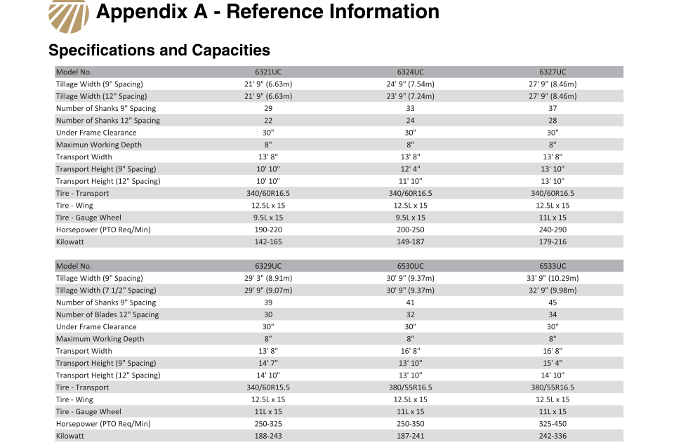
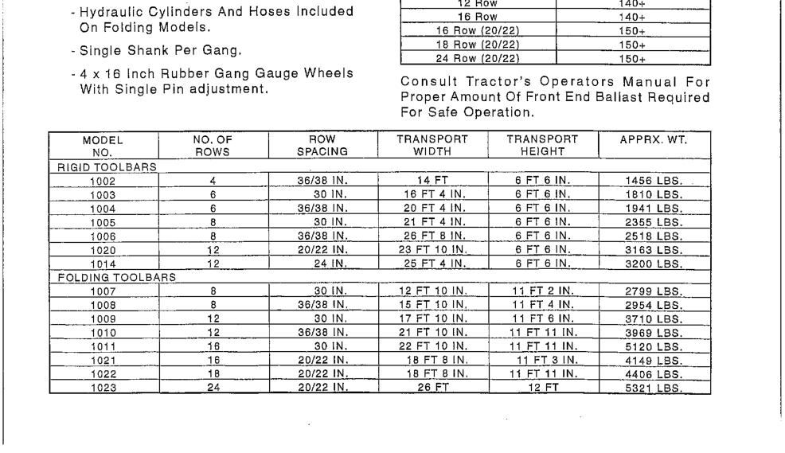
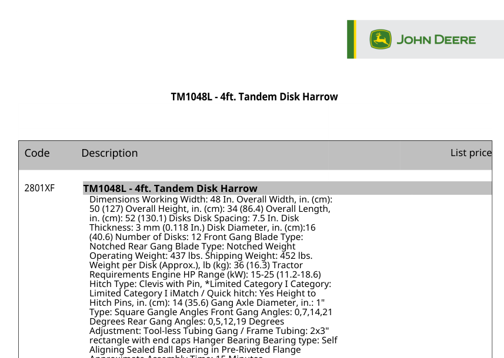
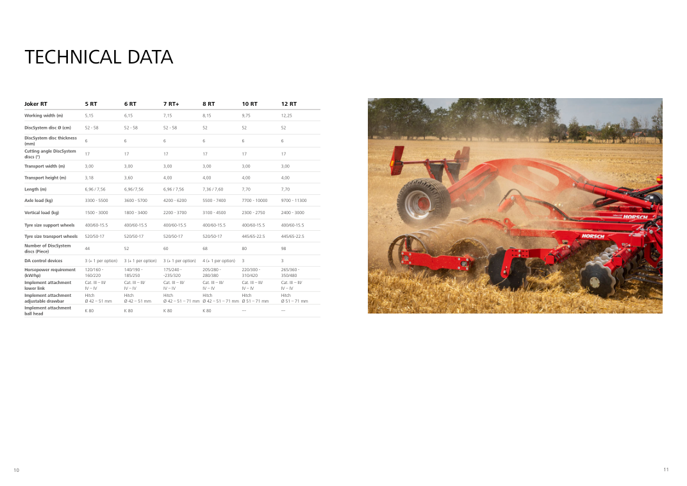
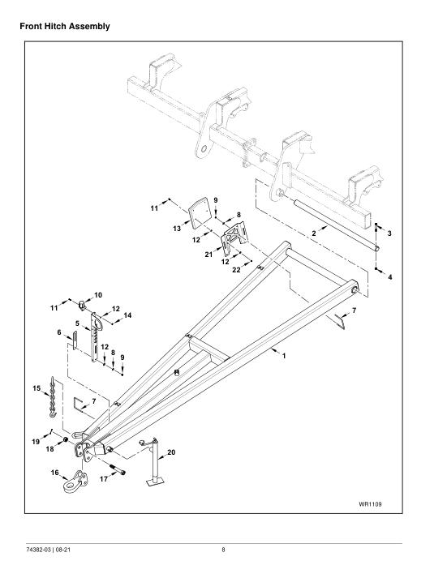
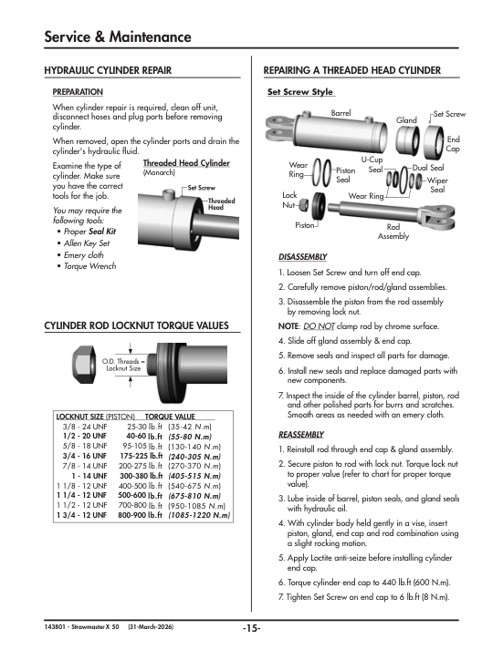
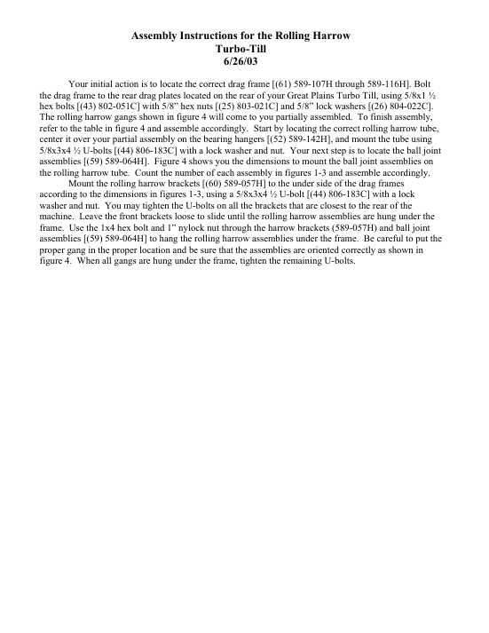
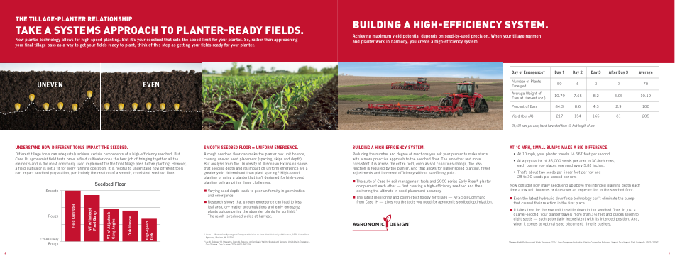

# Contributing to the equipment library

This guide is for people joining the project to help grow the **equipment library**: a
database of manufacturer specifications for tillage implements (working widths, shank or
blade counts, weights, transport dimensions...). No prior knowledge of the project is
assumed.

## What the project is, in two minutes

This library feeds the **Machinery Image Processor** (<https://github.com/DigitAgforOFE/MachineryImageProcessor>), a browser app. You load
smartphone photos of a farm implement, click on its parts, and it measures them. The
**library** in [library/manufacturers/](library/manufacturers/) is what lets the app
answer "which machine is this?". For example, a photo with 7 shanks spread over about
15 ft narrows the candidates to a few real products, whose published dimensions then
calibrate the photo.

## Who does what

- **You find documents.** You locate manufacturer brochures, spec sheets and operator's
  manuals online, check that they are new to the project, and hand them over.
- **The project owner processes them.** Turning a document into library entries is done
  on the owner's side, with an AI assistant, following the extraction rules at the end
  of this guide. You don't need to read or type any specifications.

The library and the list of known files ([library/sources.csv](library/sources.csv))
live in git. The documents themselves never do, because they are large and copyrighted.
`sources.csv` identifies every known file by a *fingerprint* (SHA-256 hash), so a
script can tell you whether a PDF you downloaded is already in the collection, even
under a different filename.

## What makes a useful document

The goal is **per-model numbers**: a table listing, for each size or model, its working
width, number of shanks/blades/bottoms/rows, weight, and transport width and height.

- **Best**: spec sheets, brochures with a "Specifications" table, product profiles.
- **Very good**: operator's manuals. They usually have a "Specifications & Capacities"
  table near the end. Manuals for older or discontinued models are welcome too.
- **Not useful**: parts books, assembly instructions, price lists, videos, and anything
  that isn't a tillage implement (drills, planters, sprayers, hitches).
- **Duplicates**: different language editions of a document we already have in English.
  `check` (below) tells you about exact copies; use judgment for translations.

Tillage implements means: chisel plows, rippers/subsoilers, field cultivators, strip-till
units, moldboard plows, row-crop cultivators, disks/disk harrows, vertical tillage tools,
rotary tillers, land rollers/packers, and mulch finishers/seedbed conditioners.

### Examples from the collection

**Perfect documents.** Open the file, find a table with one column (or row) per model,
and check that it has widths and weights. That one table is what makes the file worth
keeping.

| What it looks like | Why it's good |
|---|---|
|  | **Operator's manual, "Specifications and Capacities" appendix** (Great Plains 562-094M). One column per model: tillage width, shank count, transport width and height, horsepower. Manuals often hide this table in the last pages, so always scroll to the end. |
|  | **Old scanned manual** (Hiniker Series 1000, about 2000). Even a scan with no selectable text is great if it has a table like this: model, rows, row spacing, transport size, weight. Old and discontinued models are wanted; farmers still use them. |
|  | **Price-book or "build & price" export** (Frontier/John Deere). One model per page, but each page lists working width, number of disks, disk size and weight. A file like this covered 43 models. |
|  | **Brochure "Technical data" page** (HORSCH Joker RT). The glossy pages before it are marketing; this last page is the part that matters. If a brochure has no such page, it is probably not worth keeping. |

**Useless documents.** These look promising (right manufacturer, right machine) but
contain nothing we can use. Don't spend time collecting them:

| What it looks like | Why it's useless |
|---|---|
|  | **Parts manual** (Wil-Rich 483 Chisel Pro). Exploded drawings and part numbers only. File names often contain "parts", "P" (Great Plains "…p.pdf") or "parts catalog". |
|  | **Operator's manual with no spec table** (Degelman Strawmaster X). Hundreds of numbers, but they are torque values and repair steps, not machine dimensions. Check the table of contents for "Specifications"; if it is missing and the only numbers are torques, skip it. |
|  | **Attachment or assembly instructions** (Great Plains rolling-harrow kit). Describes a part bolted onto a machine, not the machine itself. Same for harrow kits, tanks, row units, caster wheels and hitches. |
|  | **Marketing brochure without specs** (Case IH AFS Soil Command). Nice photos and agronomy charts, but no width, weight or count for any model. |

Also not useful: translations of a document we already have in English (file names ending
in -frc, -rus, -bul, "Russian"), planters, seeders, sprayers and fertilizer carts, and saved
web pages that just repeat a brochure.

**Rule of thumb:** within a minute of opening the file, you should be able to point at a
table that lists, per model, a working width and either a weight or a shank/disk/row
count. If you can't, don't keep it.

## One-time setup

1. **Accounts**: create a GitHub account and send your username to the project owner.
   They will add you as a collaborator on
   `https://github.com/DigitAgforOFE/FarmMachineryLibrary`.
2. **Install** (all free):
   - **Git**. On a Mac, run `xcode-select --install` in Terminal. On Windows, use
     <https://git-scm.com>. If you prefer buttons over commands,
     [GitHub Desktop](https://desktop.github.com) works too.
   - **Python 3.8+** from <https://www.python.org>. On Windows, tick "Add to PATH" and
     type `py` wherever this guide says `python3`.
   - **VS Code** from <https://code.visualstudio.com> (recommended editor).
3. **Get the code**:
   ```bash
   git clone https://github.com/DigitAgforOFE/FarmMachineryLibrary.git
   cd FarmMachineryLibrary
   git config pull.rebase false     # once: lets `git pull` merge others' work into your branch
   ```
4. **Make a `Brochures` folder** inside the project. Git ignores it. Save each file
   under `Brochures/<Manufacturer>/`, using the folder names from the `manufacturer`
   column of `library/sources.csv` (e.g. `Brochures/Great Plains/`). For a manufacturer
   not listed yet, create a new folder with its usual name.

## Your assignment

The owner assigns each person **one or more manufacturers** (or a category, or a gap
such as "older Case IH models"). Open `library/sources.csv` in Excel or Google Sheets
and filter by manufacturer to see what the project already has.

## The workflow

Start a branch once:

```bash
git checkout main && git pull
git checkout -b jsmith/wil-rich          # your-name/assignment
```

Then repeat:

1. **Find files** on manufacturer websites ("literature", "brochures", "spec sheets",
   "operator's manuals"), dealer sites and the like. Save them under
   `Brochures/<Manufacturer>/`.
2. **Check what's new.** First bring in what everyone else has registered, so you don't
   collect files someone already found:
   ```bash
   git pull origin main
   python3 tools/brochures.py check
   ```
   Delete everything listed as **already in the collection** or **already handled**:
   the project has those. Keep the files listed as **NEW**.
3. **Register each new file**, so other people's `check` knows it's been found:
   ```bash
   python3 tools/brochures.py record "Brochures/Wil-Rich/2500-ripper.pdf" --status unreviewed --by jsmith
   ```
   Add `--note "..."` if there's something worth knowing, e.g. `--note "covers 1998-2004 models"`.
4. **Push your registrations** (at least weekly):
   ```bash
   python3 tools/brochures.py validate
   git add library/sources.csv
   git commit -m "Wil-Rich: register 12 new documents"
   git push -u origin jsmith/wil-rich
   ```
   The first time, open a **pull request** on GitHub from your branch to `main`. Later
   pushes update it, and the owner merges it.

   If `git pull origin main` (step 2) reports **CONFLICT in library/sources.csv**, someone
   registered files next to yours. That's normal, and you don't need to edit anything:
   ```bash
   python3 tools/brochures.py tidy        # removes the conflict marks, merges duplicate rows
   python3 tools/brochures.py validate
   git add library/sources.csv
   git commit --no-edit
   ```
   If `tidy` says a file of yours was renamed (e.g. `manual (2).pdf`), another person had
   registered a different file with the same name. Nothing else to do: the owner's
   `import` uses the new name.
5. **Hand over the files** (every week or two, so processing keeps pace):
   ```bash
   python3 tools/brochures.py export --added-by jsmith --out ~/Desktop/handoff-jsmith
   ```
   This copies only the files you registered. Zip `~/Desktop/handoff-jsmith/Brochures`
   and upload it to the project's Box folder (not by email, and not in git). Name the zip
   with your name and the date, e.g. `handoff-jsmith-2026-11-15.zip`. Running `export`
   again later includes everything you've added so far; the owner's `import` skips files
   it already has, so re-sending is harmless.
6. **After the owner processes your files**, run `git pull origin main`. Your files
   then show as processed or skipped in `sources.csv` and in the progress page.

## For the project owner: merging contributions

Contributions arrive in two parts that travel separately: the **registrations** (rows in
`library/sources.csv`, via a GitHub pull request) and the **files** (a zip in Box). The
steps below bring both together. Do them in this order, about every week or two, in your
local copy of the repository (the folder that contains `Brochures/`).

**Onboarding**: add each student as a collaborator (GitHub → the repository →
Settings → Collaborators → Add people) and give them their assignment.

### 1. Merge the pull requests

On GitHub, open **Pull requests**, then each student's request:

1. Open the **Files changed** tab. It should only touch `library/sources.csv` (new rows
   with status `unreviewed`). Anything else, such as edits to JSON files or other people's
   rows, is a reason to ask before merging.
2. If GitHub shows **"This branch has no conflicts"**, click **Merge pull request →
   Confirm merge**.
3. If it shows **"This branch has conflicts"**, don't use GitHub's editor. Merge it on
   your computer instead; `tidy` resolves the conflict:
   ```bash
   git checkout main && git pull
   git fetch origin
   git merge origin/jsmith/wil-rich       # the branch name shown on the pull request
   python3 tools/brochures.py tidy
   python3 tools/brochures.py validate
   git add library/sources.csv && git commit --no-edit
   git push                               # GitHub marks the pull request as merged
   ```

### 2. Update your copy and clean up

```bash
git checkout main && git pull
python3 tools/brochures.py tidy
python3 tools/brochures.py validate
```

Two students sometimes register the same document. Their pull requests merge without a
conflict, but `sources.csv` then lists the file twice and `validate` reports *same file as
line…*. `tidy` merges such rows, keeps the earliest finder as `added_by`, and renames one
of two *different* files registered under the same name. If `tidy` changed anything,
commit and push it (`git commit -am "Tidy sources.csv" && git push`).

### 3. Bring in the files from Box

Download each handoff zip from Box and unzip it (e.g. into `~/Downloads/handoff-jsmith`).
**Never drag a handoff's folders onto `Brochures/` in Finder.** Finder offers to
*replace* a folder with the same name, and that would delete every file you already have
for that manufacturer. Use `import`, which only adds files and never overwrites:

```bash
python3 tools/brochures.py import ~/Downloads/handoff-jsmith --dry-run   # preview
python3 tools/brochures.py import ~/Downloads/handoff-jsmith
```

`import` reports which files it copied, which you already had (skipped), and any that
are **not registered**. Those usually mean the student's pull request isn't merged yet
(go back to step 1), or they forgot to `record` them. If it renamed a file to avoid a
name clash, run `tidy` afterwards.

Then check that registrations and files match up:

```bash
python3 tools/brochures.py missing      # registered, but the file hasn't arrived
python3 tools/brochures.py check        # files you have that nobody registered ("NEW")
```

`missing` lists, per student, the registrations whose files you still need; ask those
students for a new export. Anything `check` lists as NEW can be registered by you with
`record`, or simply processed as part of the next step.

### 4. Process and publish

Every `unreviewed` row is now a file waiting to be processed. Open the repository in
Claude Code and ask it to *"process the unreviewed files"*. It follows the extraction
rules below and marks every file `processed`, `related` or `skipped`. Review the changes
(e.g. spot-check a few numbers against the PDFs), then:

```bash
python3 tools/brochures.py validate      # must show 0 errors
git add library && git commit -m "Process handoffs from jsmith, akim" && git push
python3 tools/brochures.py status --html progress.html   # optional: see progress
```

Tell the students to `git pull origin main` so they see the result. Back up `Brochures/`
to Box after each round.

## Extraction rules (for whoever processes documents)

These are the conventions the existing entries follow. Consistency matters more than
speed, because the matching code compares numbers across manufacturers. The format is in
[library/schema.md](library/schema.md).

- **Never guess.** If a value isn't in the source, leave the field out. If a table
  doesn't line up (columns don't reconcile, or a value spans an unclear set of models),
  leave that field out and explain why in `source.note`. Set `"verified": false` if you
  are unsure of anything you did keep.
- **Check numbers against the PDF's text layer** (pypdf), not only a visual read. PDF
  tables misalign easily.
- **`source.note` must name the file or its document code and the page/table**, plus
  anything a later reader would wonder about: which edition was used and why, any field
  that was omitted, oddities in the source.
- **`source.type`**: `spec_sheet` (brochure, spec sheet, product profile) or `manual`
  (operator's manual specifications table).
- **One entry per model family.** Fields shared by every size go in `constants`, and
  fields that differ per size go in `variants`. A range given only for the whole family
  goes in `constants` as a range (`workingWidthRangeFt: [7.5, 26.5]`). Don't invent
  variants from it.
- **Keep the source's units and name them**, in camelCase: `workingWidthFt`,
  `workingWidthIn`, `workingWidthM`, `weightLb`, `weightKg`, `transportHeightIn`,
  `shankSpacingIn`, `hpMin`/`hpMax`. Don't convert units. Reuse existing field names.
- **The count field depends on the category** (`shanks`, `blades`, `bottoms`, `rows`,
  `drums`). See [library/categories.json](library/categories.json). `category` must be a
  key there.
- **`id`**: `<manufacturer-slug>-<family-slug>`, lowercase with hyphens. Never rename an
  existing id.
- **Several editions**: prefer the one with a per-model table, and the newest of those.
  Name the superseded edition in the note, and mention it if the two disagree.
- **Record every file** with `tools/brochures.py record`: `processed` with `--ids`,
  `skipped` with a `--note` saying why, or `related` for a translation, parts manual or
  quick-reference version of a processed file.
